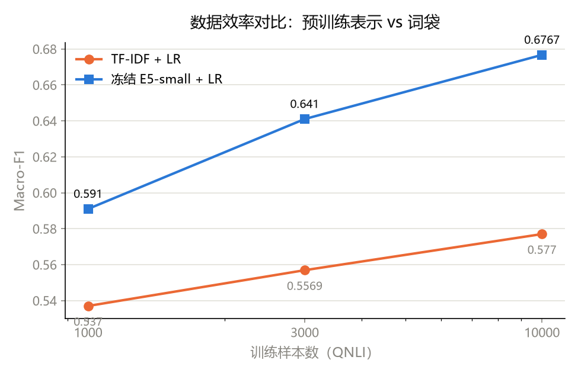

# 基于预训练文本表示的对话问答回避检测与跨场景迁移

> 深圳大学《自然语言处理》期末大作业　｜　主讲教师：陈俊扬
> 说明：本报告在「对话问答回避检测与跨场景迁移分析」实验基础上完成，扩展项选择**数据效率**。

---

## 一、背景介绍与研究问题

**回答清晰度与回避策略。** 在政治采访、客服对话和安全问答等场景中，说话者面对提问并不总是给出正面回答：有时明确回答（Clear Reply），有时含糊其辞、顾左右而言他（Ambivalent Reply），有时则明确拒绝回答（Clear Non-Reply）。"回答清晰度"（response clarity）刻画的就是"回答在多大程度上正面回应了问题"，而"回避策略"（evasion strategy）则是说话者用来规避正面回答的具体话术，例如转移话题、声称无知、反问、只回答一部分等。自动识别回答清晰度具有重要价值：在新闻与政治领域，它可以辅助事实核查和问责，判断官员是否真正回应了公众关切；在客服与安全对话中，它可以用于质检和风控，发现客服是否绕开用户问题、或模型是否在敏感问题上含糊其辞。因此，回答清晰度分类是一个兼具语言学趣味和现实应用意义的问题。

**数据集与迁移任务。** 本工作以 QEvasion 数据集为核心 [1]。QEvasion 由 Thomas 等人（Findings of EMNLP 2024）发布，收集了真实政治采访中的"问题—回答"对，标注了高层三分类标签 `clarity_label`（Clear Reply / Ambivalent Reply / Clear Non-Reply）和细粒度九分类标签 `evasion_label`（Explicit、Implicit、Dodging、General、Deflection、Partial/half-answer、Declining to answer、Claims ignorance、Clarification）。训练集 3448 条、测试集 308 条，类别分布严重不平衡：Ambivalent 占 59.2%、Clear Reply 占 30.5%、Clear Non-Reply 仅占 10.3%。迁移任务选用 GLUE 基准中的 QNLI [6]，它判断"给定问题与句子，该句子是否包含问题的答案"，是二分类（entailment / not_entailment）。两套数据拥有**共同的输入结构**：都由两个文本字段构成——一个"问题"（question）和一个"候选回答/句子"（interview_answer / sentence），因此可以共用同一套"文本对分类"的建模接口；差异在于**标签语义与粒度**：QEvasion 是主观的三分类"清晰度"判断，回答长达数百词、语义隐晦；QNLI 是更客观的二分类"是否包含答案"判断，句子短、信号明确。

**三个研究问题。** 围绕上述任务，本工作提出三个递进的研究问题：
- **RQ1（基础模型表现）**：预训练句向量（冻结 E5-small + 逻辑回归）相比传统 TF-IDF 词袋基线，在 Macro-F1 上有多少提升？提升主要来自哪个类别？
- **RQ2（跨场景迁移边界）**：统一的"字段适配器 + 编码→分类"流程能否无痛迁移到 QNLI？直接复用冻结表示与在目标数据上对比微调，性能差异说明什么？
- **RQ3（数据效率，所选扩展）**：预训练表示在少量标注数据下相比词袋的优势有多大？用 10% 的数据能否追平词袋用 100% 数据的水平？

**与普通情感分类的区别、类别不均衡与泄漏风险。** 回答清晰度分类与普通情感分类（如正/负/中性）有本质区别：情感分类的关键词信号较强（"好/坏/喜欢/讨厌"），而回避是"回答表面相关、实质未正面回应"的深层语义判断，不能只靠否定词或情感词识别；例如一句几百词的官腔式回答，字面上没有否定、也没有正面表态，却属于"含糊回避"。这使本任务比情感分类更依赖对整体语义和语用的建模。同时，类别严重不平衡（Ambivalent 是 Clear Non-Reply 的约 5.7 倍）使得准确率这一指标会严重失真——一个全预测多数类的模型准确率高达 66.9%，但毫无判别力，因此必须采用 Macro-F1 作为主指标。此外，QEvasion 数据来自特定总统的采访（训练集含 Trump 1325、Obama 1010、Bush 714、Biden 399 条），若同一采访或高度相似问答在训练/测试间泄漏，模型可能记住"来源"而非"清晰度"，因此实验采用官方划分并固定随机种子，迁移实验则从训练集分层抽样、用独立验证集测试，避免同源泄漏。

## 二、相关工作的优缺点总结

**Thomas et al.（2024）的 QEvasion 工作 [1]。** 该文定义了"回答清晰度"任务，构建了政治采访问答数据集 QEvasion，并提出包含九种回避策略的细粒度分类体系。其贡献在于提供了任务定义、标注数据与初步基线，是本实验的数据来源与问题起点。不足在于其基线主要基于传统特征，未充分探索预训练语言模型在"回避语义"建模上的潜力。

**Wang et al.（2024）的方法论文 [2]。** 该文（ACL 2024）提出一种"用大语言模型改进文本嵌入"的方法：用专有 LLM 生成覆盖 93 种语言、数十万任务的合成训练数据，再用标准对比损失（InfoNCE，即 Multiple Negatives Ranking Loss）微调开源 LLM 作为句向量模型，不到 11k 步训练即可在 BEIR 和 MTEB 基准上取得强结果，混合真实标注数据后达到当时最优。其核心启示是：**对比学习（拉近正样本、推开负样本）是训练高质量句向量的关键技术**。本实验的基线 B 即复用其思想——用 E5-small 句向量作为预训练表示，并用同标签正对做对比微调作为"改进"尝试。

**预训练表示的发展脉络。** 从 Sentence-BERT（Reimers & Gurevych, 2019）[3]、SimCSE（Gao et al., 2021）[4]，到 E5（Wang et al., 2022）[5] 与 BGE（Xiao et al., 2023），预训练句向量的主流做法是"弱监督或自监督对比预训练 + 下游微调"。E5-small 正是这条脉络中一个轻量、开源的 384 维句向量模型，适合在无 GPU 环境下作为表示器。

**三类方法的适用条件与不足。** （1）**传统特征（TF-IDF/BOW）**：实现简单、可解释，但只捕捉词表共现，无法建模"长回答是否正面回应"的整体语义，且易受高频词与回答长度影响。（2）**预训练表示（冻结句向量）**：能捕捉深层语义，开箱即用、无需大量标注，但在目标任务上的分布差异可能限制其上限。（3）**跨场景迁移**：冻结表示直接迁移省成本，但存在领域差异；在目标数据上微调能显著提升，但需要标注数据与算力。**本工作所选的数据效率扩展，正是针对第（2）类的不足**——Wang et al. 的方法仍依赖大量合成或标注数据，而真实场景常只有少量标注；我们通过 10%/30%/100% 的对比实验，验证预训练表示在**少标注数据下**相对词袋的优势是否仍然成立。

## 三、模型方法与扩展设计

**统一流程。** 本实验保留两个层次的基线并统一数据划分、标签映射与指标（主指标 Macro-F1，辅助 Accuracy、类别级 P/R/F1、混淆矩阵，随机种子固定 42）：
- **基线 A（传统特征）**：TF-IDF（unigram，`max_features=30000`，`sublinear_tf=True`）+ 逻辑回归。
- **基线 B（预训练表示）**：`intfloat/e5-small-v2`（384 维）把拼接文本编码成句向量 + 逻辑回归。

**字段适配器。** 两套数据通过统一接口复用：

| 统一字段 | QEvasion（源） | QNLI（迁移） |
|---|---|---|
| text_a | question | question |
| text_b | interview_answer | sentence |
| label | clarity_label（3 类） | label（0/1） |
| group | president / title | idx |

输入统一拼接为 `"[Q] {text_a} [A] {text_b}"`。从原任务迁移到新场景时，只需改 `text_b` 的字段名（`interview_answer`→`sentence`）与标签映射（三分类→二分类），编码与分类代码完全不变，这正是"可复用"的关键设计。

**数据效率扩展的设计。** 假设：预训练表示在少标注数据下更有优势，因为它自带通用语义先验，无需从零学习词表统计。实现步骤：在 QNLI 训练集中分层抽样 10000 条作为训练池，分别取 10%（1000）、30%（3000）、100%（10000）条训练 TF-IDF+LR 与冻结 E5-small+LR，测试集固定为 QNLI 官方验证集 5463 条。比较设置：两条方法在相同数据量、相同逻辑回归设置下对比 Macro-F1，并观察差距随数据量的变化。

**训练参数（保证可复现）。**

| 模型 | 向量长度 | 最大长度 | 学习率 | 轮数 | 随机种子 |
|---|---|---|---|---|---|
| TF-IDF + LR | 30000 | 不截断 | — | — | 42 |
| 冻结 E5-small + LR | 384 | 512 | — | — | 42 |
| 对比微调 E5-small + LR | 384 | 512 / 128 | 2e-5 | 1 | 42 |

逻辑回归统一 `max_iter=2000`、`class_weight='balanced'`；对比微调用 `MultipleNegativesRankingLoss`（InfoNCE）[2]。运行环境：Python 3.14.2、Windows 11、CPU、22 核、约 33.8 GB 内存。

## 四、实验结果与综合分析

**（一）总体性能。** 在原任务 QEvasion 上，结果如表 1 所示。

**表1 总体性能（QEvasion，主指标 Macro-F1）**

| 模型 | Accuracy | Macro-P | Macro-R | Macro-F1 |
|---|---|---|---|---|
| 多数类基线 | 0.6688 | 0.2229 | 0.3333 | 0.2672 |
| TF-IDF + LR（基线A） | 0.5195 | 0.4032 | 0.4423 | 0.4147 |
| 冻结 E5-small + LR（基线B） | **0.5682** | **0.4522** | **0.5258** | **0.4715** |
| 对比微调 E5-small + LR | 0.5584 | 0.4245 | 0.4951 | 0.4360 |

回答 RQ1：由表 1 可见，冻结 E5-small + LR 的 Macro-F1 比 TF-IDF 基线高 5.7 个点（0.4147→0.4715），验证了预训练表示的优越性。值得注意的是，对比微调（0.4360）反而**低于**冻结基线（0.4715），说明在这个三分类、标签边界主观、测试集仅 308 条的小任务上，微调没有带来增益——这与 RQ2 的迁移结果形成鲜明对照（见下）。多数类基线 Accuracy 高达 66.9% 而 Macro-F1 仅 26.7%，再次印证必须以 Macro-F1 为主指标。

**（二）类别级结果。** 两个基线的类别级 F1 对比与最佳模型（冻结 E5-small + LR）的详细指标如表 2（其中 Precision/Recall 为最佳模型的，F1 列同时给出 TF-IDF+LR 与冻结 E5-small+LR 的对比）。

**表2 类别级结果与混淆矩阵（行=真实，列=预测）**

| 类别 | 样本数 | TF-IDF+LR F1 | E5 Precision | E5 Recall | E5 F1 |
|---|---|---|---|---|---|
| Clear Reply | 79 | 0.2530 | 0.3158 | 0.3038 | 0.3097 |
| Ambivalent Reply | 206 | 0.6632 | 0.7366 | 0.6650 | 0.6990 |
| Clear Non-Reply | 23 | 0.3279 | 0.3043 | 0.6087 | 0.4058 |
| **Macro Average** | 308 | 0.4147 | 0.4522 | 0.5258 | **0.4715** |

|  | 预测 Clear Reply | 预测 Ambivalent | 预测 Clear Non-Reply |
|---|---|---|---|
| Clear Reply | 24 | 46 | 9 |
| Ambivalent | 46 | 137 | 23 |
| Clear Non-Reply | 6 | 3 | 14 |

最难的是 **Clear Reply**（见表2，F1 仅 0.31），它有 46 条被误判成 Ambivalent（占其总数一半以上），说明"明确回答"与"含糊回避"的语义边界最模糊、最易混淆。预训练表示相对词袋的提升主要来自 **Clear Non-Reply**（见表2，F1 从 0.3279 提升到 0.4058），说明句向量能更好地抓住"明确拒绝/声称无知"这类抽象回避语义。

**（三）跨场景迁移。** 迁移到 QNLI 的结果如表 3。

**表3 原任务与迁移任务对比（QNLI）**

| 实验设置 | Accuracy | Macro-F1 | 主要结论 |
|---|---|---|---|
| 原方法基线（QEvasion） | 0.5682 | 0.4715 | 原任务三分类、难 |
| 迁移数据基线（TF-IDF+LR） | 0.5777 | 0.5770 | 词袋在 QNLI 上勉强可用 |
| 直接迁移（冻结 E5-small+LR） | 0.6767 | 0.6767 | 复用冻结表示，比词袋高约 10 点 |
| 适配后训练（对比微调+LR） | 0.8305 | 0.8305 | 微调再涨约 15 点 |

回答 RQ2：由表 3 可见，统一的字段适配器和"编码→分类"流程确实可以**无痛迁移**——直接复用冻结表示（0.677）就显著超过迁移数据的词袋基线（0.577），证明预训练表示是跨任务通用的；而对比微调（0.831）又比直接迁移高约 15 点，证明在目标数据上适配模型参数仍有明显收益。这与 RQ1 中原任务上微调失效形成对比：**微调的收益取决于任务的难易与数据量，而不是方法本身失效**——QNLI 二分类、文本短、数据充足，微调立即见效；QEvasion 三分类、标签主观、测试小，微调过拟合而无增益。

**（四）数据效率扩展（RQ3）。** 结果如表 4 与图 1。

**表4 数据效率对比（QNLI，10%/30%/100%）**

| 比例 | 训练样本数 | TF-IDF+LR Macro-F1 | 冻结 E5-small+LR Macro-F1 | E5 领先 |
|---|---|---|---|---|
| 10% | 1000 | 0.5370 | 0.5910 | +0.054 |
| 30% | 3000 | 0.5569 | 0.6410 | +0.084 |
| 100% | 10000 | 0.5770 | 0.6767 | +0.100 |

图1：数据效率学习曲线（横轴为训练样本数，纵轴 Macro-F1）。

回答 RQ3：由表 4 可见，冻结 E5-small 在每一档数据量下都稳定优于 TF-IDF，且领先幅度随数据增多而扩大（0.054→0.084→0.100），说明预训练句向量作为更高质量的语义特征，能比词袋更充分地利用新增标注数据。最能体现"数据效率"的一点是：**E5-small 只用 10% 的训练数据（1000 条）就达到 Macro-F1 0.591，已经超过 TF-IDF 用满 100% 数据（10000 条）的 0.577**——即用约十分之一的标注量就追平了词袋基线的全量水平。这直接回答了扩展的预期结论：在标注数据稀缺的场景下，预训练表示的优势更加突出。

**（五）误判案例分析。** 从基线 B 的 133 个错误样本中选取 5 个典型，如表 5。

**表5 典型误判样本**

| 序号 | 问题摘要 | 回答摘要 | 真实标签 | 预测标签 | 误差类型 |
|---|---|---|---|---|---|
| 1 | 是否准备把伊拉克战争命运交给下任总统？ | 约 598 词，反复说"等 Petraeus 将军向国会汇报"，不正面回应（三类概率 .368/.453/.179） | Clear Non-Reply | Ambivalent | 长而空泛 |
| 2 | 若欧盟收不到伊朗答复，G8 是否施压？ | "我说过不回答假设性问题……"明确拒绝后仍继续谈 G8（.336/.332/.332） | Clear Non-Reply | Clear Reply | 明确拒答 |
| 3 | 卡斯特罗目前身体状况？ | "古巴社会不透明，我只知道传闻……"（.358/.382/.260） | Clear Non-Reply | Ambivalent | 声称无知 |
| 4 | 中国在非洲发展中的作用？ | "我想让 John 先说，他毕竟跟各国领导人打过交道……"（.472/.433/.096） | Ambivalent | Clear Reply | 主题转移 |
| 5 | 对 G20 同僚在此决策的看法？ | 仅 "Okay...." 一个词（.303/.296/.402） | Ambivalent | Clear Non-Reply | 数据噪声/边界模糊 |

误判分布（见表2混淆矩阵）：Ambivalent↔Clear Reply 混淆最多（92 条），Ambivalent→Clear Non-Reply 23 条，其余较少。**性能瓶颈主要来自标签边界模糊与长回答的语义建模，而非来源群体**——测试集 president 字段为空，无法按总统验证，但从案例看，误判集中在"明确回答 vs 含糊回避"这条最难的主边界上。

**（六）综合分析。** 性能变化可归因于三个因素：其一，**数据分布与标签边界**——原任务三分类、主观、不平衡，是 Macro-F1 上不去的主因；QNLI 二分类、客观、均衡，因此分数普遍高。其二，**模型表示**——预训练句向量在所有场景都优于词袋，是唯一稳定有效的改进方向。其三，**来源群体**——受测试集 president 缺失限制，无法验证来源效应，但分层抽样与固定划分已尽量控制了泄漏。本结论的适用范围是"文本对语义关系分类"这类任务；在答案极短、标签噪声大的样本上，任何方法都难保证鲁棒。

## 五、代码与结果上传 GitHub

（代码、配置、预测文件与结果均已整理在 `code/` 与 `results/` 目录，可重复运行。GitHub 仓库链接：【待上传后填入】）

## 六、参考文献

[1] Thomas, P., et al. "I Never Said That": A Dataset, Taxonomy and Baselines on Response Clarity Classification. *Findings of EMNLP 2024*. https://aclanthology.org/2024.findings-emnlp.300/

[2] Wang, L., et al. Improving Text Embeddings with Large Language Models. *ACL 2024*, pp.11897-11916. arXiv:2401.00368.

[3] Reimers, N., & Gurevych, I. Sentence-BERT: Sentence Embeddings using Siamese BERT-Networks. *EMNLP-IJCNLP 2019*.

[4] Gao, T., Yao, X., & Chen, D. SimCSE: Simple Contrastive Learning of Sentence Embeddings. *EMNLP 2021*.

[5] Wang, L., et al. Text Embeddings by Weakly-Supervised Contrastive Pre-training. *arXiv:2212.03533*, 2022.

[6] Wang, A., Singh, A., Michael, J., Hill, F., Levy, O., & Bowman, S. R. GLUE: A Multi-Task Benchmark and Analysis Platform for Natural Language Understanding. *EMNLP 2018*.
