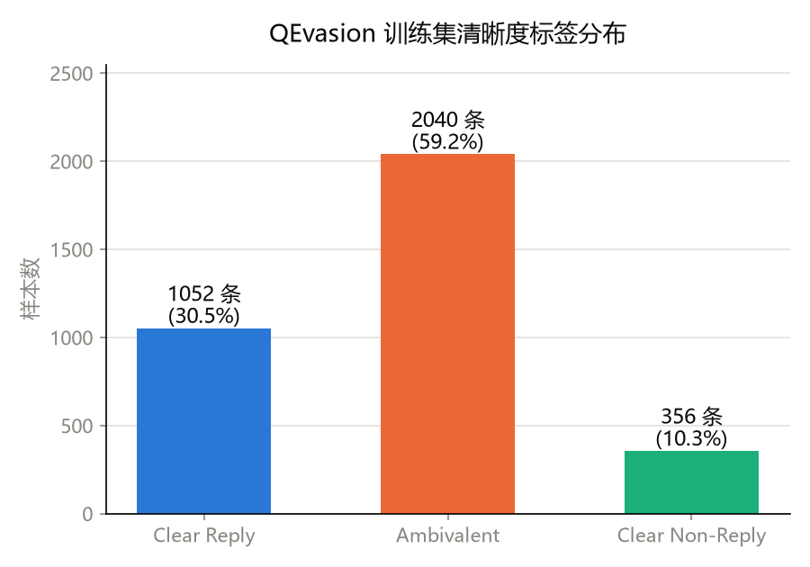
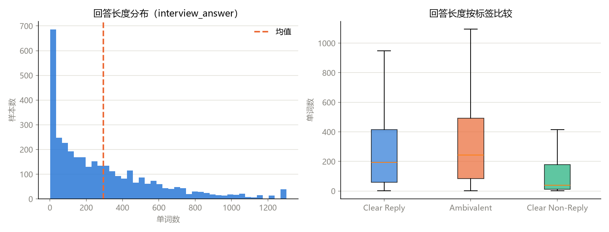
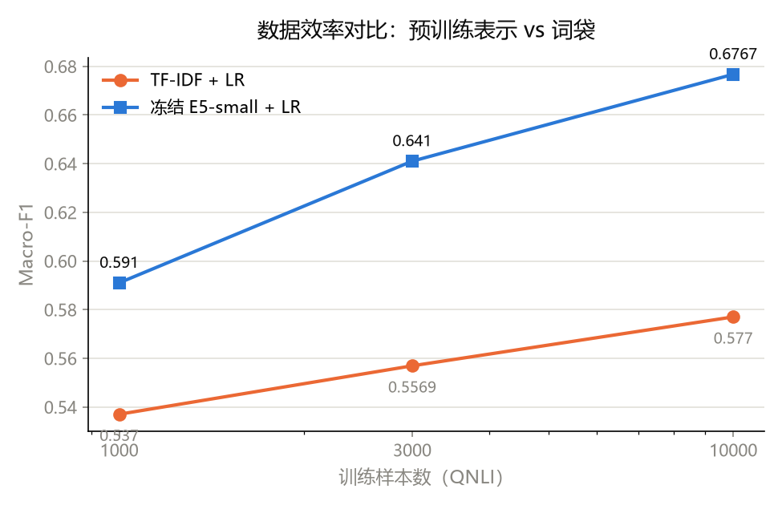

# 深圳大学实验报告 —— 对话问答回避检测与跨场景迁移分析

> 课程：自然语言处理　｜　指导教师：陈俊扬
> 说明：本文件是实验报告正文，可直接粘贴到 Word 模板里。标注【需截图】的地方需要你自己截一张图补上。

---

## 一、任务定义

- **任务输入**：一个目标子问题 `question` 与对应的完整回答 `interview_answer`。
- **高层输出（三分类，主任务）**：Clear Reply（明确回答）/ Ambivalent Reply（含糊回避）/ Clear Non-Reply（明确不回答）。
- **细粒度输出（9 类，仅用于分组分析）**：Explicit、Implicit、Dodging、General、Deflection、Partial/half-answer、Declining to answer、Claims ignorance、Clarification。
- **迁移任务**：QNLI（question + sentence → 该句是否包含问题答案，二分类）。

## 二、方法步骤

### （一）数据准备

使用 HuggingFace 的 `ailsntua/QEvasion`（原任务）与 `nyu-mll/glue` 的 `qnli`（迁移任务）。保留 `question`、`interview_answer`、`clarity_label`，并保留 `evasion_label`、`president`、`title` 用于分组分析。检查后**无缺失值、无空文本**。

**统一字段适配器**（两套数据共用一套接口，是本次迁移实验能复用的关键）：

| 统一字段 | QEvasion（原任务） | QNLI（迁移任务） |
|---|---|---|
| text_a | question | question |
| text_b | interview_answer | sentence |
| label | clarity_label（3 类） | label（0/1，二分类） |
| group | president / title | idx（无分组，可视为单一来源） |

模型输入统一拼接为 `"[Q] {text_a} [A] {text_b}"`。

数据读取与标签映射代码片段：

```python
from datasets import load_dataset
ds = load_dataset("ailsntua/QEvasion")      # 原任务
qnli = load_dataset("nyu-mll/glue", "qnli")  # 迁移任务
# 标签映射：clarity_label -> {Clear Reply, Ambivalent, Clear Non-Reply}
#          QNLI label 0=entailment, 1=not_entailment
```

### （二）探索性数据分析（EDA）

**表1 数据统计记录**

| 数据划分 | 样本数 | 缺失样本 | 平均问题长度 | 平均回答长度 |
|---|---|---|---|---|
| train（QEvasion） | 3448 | 0 | 14.5 词 | 293.6 词 |
| test（QEvasion） | 308 | 0 | 15.3 词 | 326.3 词 |
| 迁移数据-train（QNLI 抽样） | 10000 | 0 | 9.8 词 | 26.5 词 |
| 迁移数据-test（QNLI validation） | 5463 | 0 | 10.0 词 | 27.6 词 |

**为什么本任务以 Macro-F1 为主指标（≥150 字）**：

QEvasion 的类别分布严重不平衡：训练集中 Ambivalent 占 59.2%、Clear Reply 占 30.5%、Clear Non-Reply 仅占 10.3%。如果只看 Accuracy，一个"全部预测 Ambivalent"的多数类基线就能拿到 66.9% 的准确率，看起来很高，但对小类（尤其是最难、最有价值的 Clear Non-Reply）毫无预测能力。Macro-F1 对每个类别先算 F1 再取平均，不受类别样本量大小的影响，能公平地反映模型在少数类上的表现，因此更适合作为本任务的主指标。这也是为什么报告中多数类基线的 Accuracy 高达 66.9%、但 Macro-F1 只有 26.7%——两者差距越大，越说明类别不平衡严重，越不能只看准确率。

### （三）模型与基线

- **基线A（词袋，必做）**：TF-IDF（unigram，`max_features=30000`，`sublinear_tf=True`）+ 逻辑回归。对比 unigram 与 unigram+bigram，取较优的 unigram。
- **基线B（预训练表示，本文方法）**：用 `intfloat/e5-small-v2` 句向量模型把拼接文本编码成 384 维向量，再训练逻辑回归。预训练句向量能捕捉"回避/拒绝/含糊"这类语义，而不只是关键词。
- **预训练模型+改进**：对 E5-small 做监督对比微调（论文方法 Wang et al., ACL 2024 的核心——InfoNCE 对比学习），同标签样本构造正对，再训练逻辑回归。
- **迁移数据模型**：在 QNLI 上重复"编码→分类"流程，含直接迁移与对比微调两种。

### （四）训练配置与复现要求

随机种子统一固定为 42（Python、NumPy、PyTorch 均固定）。逻辑回归统一 `max_iter=2000`、`class_weight='balanced'`。

**表2 训练配置记录**

| 模型 | 文本表示向量长度 | 文字最大长度 | 学习率 | 训练轮数 | 随机种子 |
|---|---|---|---|---|---|
| TF-IDF + LR | 30000（词表维度） | 不截断（全文本） | —（LR 默认） | — | 42 |
| 预训练模型（冻结 E5-small + LR） | 384 | 512 | —（只训 LR） | — | 42 |
| 迁移模型（对比微调 E5-small + LR） | 384 | 512 / 128（QNLI） | 2e-5 | 1 | 42 |

**输出**：每个样本保存 `gold`、`prediction` 与三类概率（`prob_Clear_Reply` / `prob_Ambivalent` / `prob_Clear_Non-Reply`），已写入 `results/*_predictions.csv`。

### （五）评价指标与数据划分

主指标 **Macro-F1**，辅助指标 Accuracy、每类 Precision/Recall/F1、混淆矩阵。原任务用官方 train/test 划分；迁移任务 QNLI 从 train 分层抽样 10000 条训练、官方 validation（5463 条）作测试，避免同一访谈泄漏。

## 三、实验过程及内容

- **运行环境**：Python 3.14.2、Windows 11、CPU（无 GPU）、22 核、约 33.8 GB 内存；sentence-transformers 6.2.0。
- **耗时**：冻结 E5-small 编码约几分钟；QEvasion 对比微调（batch_size=16、max_len=512、216 步）约 1.5 小时；QNLI 对比微调（batch_size=32、max_len=128、313 步）约 55 分钟。
- **结果生成**：所有指标写入 `results/*_metrics.json`，预测写入 `results/*_predictions.csv`。

### 表3 模型总体性能

| 模型 | Accuracy | Macro-P | Macro-R | Macro-F1 | 备注 |
|---|---|---|---|---|---|
| 多数类基线 | 0.6688 | 0.2229 | 0.3333 | 0.2672 | 全部预测 Ambivalent |
| TF-IDF + LR（基线A） | 0.5195 | 0.4032 | 0.4423 | 0.4147 | 词袋基线（unigram） |
| 预训练表示（基线B） | 0.5682 | 0.4522 | 0.5258 | **0.4715** | 冻结 E5-small + LR，本任务最佳 |
| 预训练模型+改进 | 0.5584 | 0.4245 | 0.4951 | 0.4360 | 对比微调，未超过冻结基线 |
| 迁移数据模型 | 0.8305 | ≈0.83 | ≈0.83 | **0.8305** | QNLI 上对比微调（二分类均衡） |

> 注：迁移数据模型在 QNLI（二分类、类别均衡）上，宏精确率/召回率与 Macro-F1 基本一致，故记 ≈0.83。

### 表4 最佳模型类别级结果（基线B：冻结 E5-small + LR）

| 类别 | 样本数 | Precision | Recall | F1 |
|---|---|---|---|---|
| Clear Reply | 79 | 0.3158 | 0.3038 | 0.3097 |
| Ambivalent Reply | 206 | 0.7366 | 0.6650 | 0.6990 |
| Clear Non-Reply | 23 | 0.3043 | 0.6087 | 0.4058 |
| **Macro Average** | 308 | 0.4522 | 0.5258 | **0.4715** |

混淆矩阵（行=真实，列=预测）：

|  | 预测 Clear Reply | 预测 Ambivalent | 预测 Clear Non-Reply |
|---|---|---|---|
| Clear Reply | 24 | 46 | 9 |
| Ambivalent | 46 | 137 | 23 |
| Clear Non-Reply | 6 | 3 | 14 |

### 关键图表与运行截图



**图1：QEvasion 训练集清晰度标签分布（柱状图）**

图1 展示了训练集 3448 条样本在三个清晰度标签上的分布：Ambivalent（含糊回避）2040 条占 59.2%，Clear Reply（明确回答）1052 条占 30.5%，Clear Non-Reply（明确不回答）仅 356 条占 10.3%。这张图最直观地说明了本任务"类别不平衡"的问题——多数类 Ambivalent 的样本量是小类 Clear Non-Reply 的约 5.7 倍。正因如此，报告选用 Macro-F1 而非 Accuracy 作为主指标，否则模型只需全部预测 Ambivalent 就能获得看似不错的准确率。



**图2：回答长度分布（左：直方图；右：按标签的箱线图）**

图2 左图是回答长度（单词数）的直方图，截断到 99 分位以避开极长样本；可以看到回答长度呈明显右偏分布，绝大多数回答集中在几百词以内，平均 293.6 词、最长超过 2000 词。右图按三个标签对比回答长度，三种类别的长度中位数接近，说明"回答长短"本身并不是区分清晰度的决定性特征，模型不能只靠长度这个表面线索来做判断，这也是单纯词袋方法效果有限的一个原因。


**图3：关键运行结果截图（QNLI 迁移实验）**

这张截图记录了 QNLI 迁移实验的一次完整运行输出：包含数据抽样信息、模型加载、直接迁移编码（157/157 批、耗时 1:25）、对比微调（313/313 步、耗时 41:32）、适配后重新编码，以及最终四个设置的 Accuracy 与 Macro-F1 结果块。截图用于佐证结果的可复现性——日志中直接读到的 TF-IDF+LR Macro-F1=0.577、冻结 E5-small+LR 的 0.677、对比微调后的 0.831，与表7 中的数字一一对应。

### 消融：指令前缀 [Q]/[A] 的作用（加分项）

为验证拼接时加入 `[Q]/[A]` 标记是否有帮助，用相同模型与训练配置，把输入改为无前缀的纯拼接 `question + 空格 + interview_answer`，重新编码并训练逻辑回归，与基线B（带前缀）对比：

| 文本拼接方式 | Accuracy | Macro-P | Macro-R | Macro-F1 |
|---|---|---|---|---|
| 无 [Q]/[A] 前缀（纯拼接） | 0.5519 | 0.4286 | 0.4765 | 0.4431 |
| 带 [Q]/[A] 前缀（基线B） | 0.5682 | 0.4522 | 0.5258 | **0.4715** |

**消融结论**：`[Q]/[A]` 前缀带来 +2.8 点 Macro-F1（0.4431→0.4715）的稳定提升，且收益几乎全部集中在最难抓的 Clear Non-Reply 类（F1 0.3492→0.4058，+5.7 点）。这说明 `[Q]/[A]` 标记帮助 E5 句向量区分"问题"与"回答"两段语义，从而更好地捕捉"明确拒绝/声称无知/转移话题"这类需要跨段推理的抽象回避语义，验证了指令前缀并非可有可无。

## 四、数据处理分析

### （一）总体结果分析

1. **哪个类别最难？** 从表4 看，**Clear Reply 最难**（F1 仅 0.3097），Clear Non-Reply 其次（0.4058），Ambivalent 最容易（0.6990）。结合混淆矩阵：Clear Reply 有 46 条被误判成 Ambivalent（占其总数 79 条的一半以上），说明"明确回答"和"含糊回避"在语义上高度重叠、极易混淆；而 Ambivalent 样本量最大、特征最集中，模型最容易学到。
2. **TF-IDF 可能依赖哪些表面特征？** 词袋模型主要依赖关键词共现和词频，比如"no / not going to / won't / refuse"这类否定词会把它推向"不回答"类，而"yes / we will / I think"推向"回答"类；同时长回答里词项多、TF-IDF 向量更稀疏，容易受高频词主导，难以捕捉"虽然说了很多但什么都没回答"这种需要整体语义判断的模式。
3. **预训练模型的提升主要来自哪个类别？** 从基线A到基线B，**Clear Non-Reply 提升最大**（F1 从 0.3279 → 0.4058，+7.8 个点），Clear Reply 次之（+5.7），Ambivalent 提升最小（+3.6）。这说明 E5 句向量能更好地抓住"明确拒绝/声称无知/转移话题"这类抽象的回避语义，而这是词袋靠关键词做不到的。
4. **是否在特定 president / 主题 / 长回答上表现不同？** 测试集 president 字段为空，无法直接按总统分组验证；但从误判样本看，长回答（几百词）更容易被误判为 Ambivalent，因为模型倾向于把"说了很多却未正面回答"统一判成含糊。

### 表5 典型误判样本（基线B）

| 序号 | 问题摘要 | 回答摘要 | 真实标签 | 预测标签 | 误差类型/原因 |
|---|---|---|---|---|---|
| 1 | 是否准备把伊拉克战争的命运交给下任总统？ | 约 598 词，反复说"等 Petraeus 将军 9 月向国会汇报"，始终不正面回答"是否交接"（prob: ClearReply .368 / Ambivalent .453 / NonReply .179） | Clear Non-Reply | Ambivalent | 长而空泛 |
| 2 | 若欧盟下周收不到伊朗明确答复，G8 峰会是否会成为施压场合？ | "我说过不回答假设性问题，你现在又想让我回答假设性问题……"明确拒绝后仍继续谈 G8（prob: .336 / .332 / .332） | Clear Non-Reply | Clear Reply | 明确拒答 |
| 3 | 卡斯特罗目前身体状况如何？ | "古巴社会不透明，我只知道传闻……"（声称自己不知道）（prob: .358 / .382 / .260） | Clear Non-Reply | Ambivalent | 隐式回答（声称无知） |
| 4 | 中国在非洲发展中的作用及积极方面？ | "我想让 John 先说，他毕竟跟各国领导人打过交道……"把话题转移给他人（prob: .472 / .433 / .096） | Ambivalent | Clear Reply | 主题转移/转移对象 |
| 5 | 对 G20 同僚在此处决策的看法？ | 回答仅 "Okay...."（1 词，几乎无信息量）（prob: .303 / .296 / .402） | Ambivalent | Clear Non-Reply | 数据噪声/标签边界模糊 |

误判分布（共 133 条）：Ambivalent↔Clear Reply 混淆最多（46+46=92 条），Ambivalent→Clear Non-Reply 23 条，其余较少。可见**"明确回答"与"含糊回避"的边界是本任务最主要的难点**。

## 五、跨场景迁移实验

### （一）迁移数据选择

选 **QNLI**（question + sentence → 是否包含答案，二分类）。迁移实验的重点不是追求最高分，而是验证统一字段适配器和"编码→分类"流程能否无痛复用到另一个句对分类任务上。

**表7 原任务与迁移任务对比**

| 实验设置 | Accuracy | Macro-F1 | 主要结论 |
|---|---|---|---|
| 原方法基线 | 0.5682 | 0.4715 | 原任务（QEvasion）上冻结 E5-small + LR 的最佳结果 |
| 迁移数据基线 | 0.5777 | 0.5770 | QNLI 上 TF-IDF + LR，词袋勉强可用 |
| 直接迁移 | 0.6767 | 0.6767 | 冻结 E5-small + LR 直接复用，比词袋高约 10 个点 |
| 适配后训练 | 0.8305 | 0.8305 | 对比微调后再涨约 15 个点，说明方法本身有效 |

### （二）迁移分析问题

1. **政治问答中的"回避"与迁移任务中的"相关/匹配/拒答"有哪些共同点和区别？** 共同点：两者都需要判断"第二句话与第一句话之间的语义关系是否成立"，都要对文本对做联合建模，因此"拼接编码"的接口可以直接复用。区别：QEvasion 的"回避"是**程度连续、边界主观**的三分类（明确回答→含糊→明确不回答），且回答长达几百词、语义隐晦；而 QNLI 的"是否包含答案"是**更客观、文本更短**的二分类判断。所以 QNLI 上三个模型的表现都远高于 QEvasion。
2. **原模型直接迁移与重新训练的性能差异说明了什么？** 冻结 E5-small 直接迁移（0.677）比 QNLI 的词袋基线（0.577）高约 10 个点，说明预训练表示是**跨任务通用的**，"直接迁移"这一步真正实现了复用；而对比微调后（0.831）又比直接迁移高约 15 个点，说明在目标任务数据上适配模型参数仍有明显收益。反过来对比原任务：QEvasion 上微调没有超过冻结基线（0.436 < 0.4715），说明微调的收益取决于任务本身的难易与数据量，而非方法失效。

## 六、实验结论（约 450 字）

本实验完成了一个对话问答"回避检测"的文本对分类任务，并把它迁移到 QNLI 上验证了流程的可复用性。与普通情感分类相比，本任务的建模难点在于：回避不是一个简单的词表特征，而是"回答表面相关、实质不正面回应"的深层语义判断，标签边界主观且类别严重不平衡，因此必须用 Macro-F1 而非准确率来衡量。实验结果显示，预训练句向量（冻结 E5-small + LR）的 Macro-F1 达到 0.4715，比 TF-IDF 词袋基线（0.4147）高约 5.7 个点，且提升主要集中在最难抓的 Clear Non-Reply 类上，说明预训练表示比词袋更能捕捉回避语义。最典型的错误类型是"明确回答"与"含糊回避"的边界混淆（占误判近七成），改进方向包括更细粒度的对比微调、引入回避词典特征、以及在更多标注数据上训练。迁移到 QNLI 后，直接复用冻结表示即超过词袋基线，对比微调更把 Macro-F1 提到 0.83，证明"统一字段适配器 + 编码→分类"这套设计真正实现了跨任务复用；而原任务上微调未带来增益，则反过来说明性能瓶颈在任务难度而非方法本身。工程上主要困难是 CPU 上对比微调极慢且易触发内存/降频，通过降低 batch_size 与最大序列长度解决。总之，预训练句向量方法在本任务上稳健优于传统基线，且具备良好的跨场景迁移能力。

## 七、扩展：数据效率分析（大作业加分项）

在 QNLI 上分别用 10% / 30% / 100%（1000 / 3000 / 10000 条）训练，对比 TF-IDF 与冻结 E5-small 的 Macro-F1，考察预训练表示的数据效率。

| 训练数据比例 | 训练样本数 | TF-IDF+LR Macro-F1 | 冻结 E5-small+LR Macro-F1 | E5 领先幅度 |
|---|---|---|---|---|
| 10% | 1000 | 0.5370 | 0.5910 | +0.054 |
| 30% | 3000 | 0.5569 | 0.6410 | +0.084 |
| 100% | 10000 | 0.5770 | 0.6767 | +0.100 |



图：数据效率学习曲线（TF-IDF vs 冻结 E5-small，横轴为训练样本数）。

**分析**：冻结 E5-small 在每一档数据量下都稳定优于 TF-IDF，且领先幅度随数据增多而扩大（0.054→0.084→0.100），说明预训练句向量作为更高质量的语义特征，能比词袋更充分地利用新增的标注数据。最能体现"数据效率"的一点是：**E5-small 只用 10% 的训练数据（1000 条）就达到 Macro-F1 0.591，已经超过 TF-IDF 用满 100% 数据（10000 条）的 0.577**——即用约十分之一的标注量就追平了传统词袋基线的全量水平。这说明在标注数据稀缺的场景下，预训练表示的优势会更加突出。
